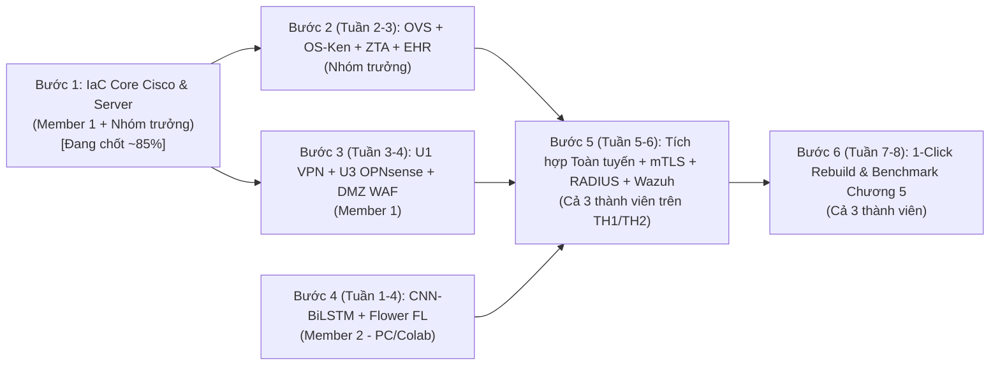

# Kế Hoạch Phát Triển & Bảng Theo Dõi Tiến Độ Đồ Án (6 Bước)

> **Tài liệu sống (Living Tracker):** Đây là bảng điều phối trung tâm cho toàn bộ đồ án tốt nghiệp **`hospital-zta-sdn-fl`** (từ Bước 1 đến Bước 6). Mỗi khi một thành viên hoàn thành hạng mục nào, đánh dấu `[x]` vào checklist tương ứng, cập nhật bảng Tổng quan ở Mục 1 và ghi ngắn gọn vào Nhật ký ở Mục 9 trong PR của mình.

---

## 1. Bảng Tổng Quan Tiến Độ 6 Bước (Master Tracking Table)

| Bước | Thời gian dự kiến | Nội dung chính | Người phụ trách chính | Tiêu chí hoàn thành (Đầu ra bắt buộc) | Trạng thái | Tiến độ |
| :--- | :--- | :--- | :--- | :--- | :--- | :---: |
| **Bước 1** | Tuần 1 *(Đang chốt)* | Nền tảng IaC Core Cisco + `HOSPITAL-SERVERS` | **Member 1** (Switch + `.unl`) & **Nhóm trưởng** (Server + duyệt PR) | `make deploy-step1` & `make verify-step1` đạt `failed=0`; file `hospital_step1.unl` nằm trong `infra/eveng/`; test 3 ca VPCS (Guest chặn TCP/ICMP, IoMT chặn Internet/Bác sĩ, HSRP Failover) PASS. | 🔄 Đang hoàn tất nghiệm thu | **~85%** |
| **Bước 2** | Tuần 2–3 | Lõi SDN (`OVS` + `OS-Ken`) & ZTA Closed-Loop (`Server 1`) + EHR (`Server 3`) | **Nhóm trưởng** | Thay/chèn OVS cho phân khu IoMT (có SPAN thật + OpenFlow 1.3); chặn di chuyển ngang L2 trong VLAN 300; bắn JSON Alert vào `.200.10` → OVS tự cài OpenFlow `DROP` trong `< 2s`; EHR trả đúng `401`/`403`/`200`. | ⏳ Chưa bắt đầu | **0%** |
| **Bước 3** | Tuần 3–4 *(Song song)* | Vành đai Biên: `U1` Border/VPN + `U3` OPNsense NGFW + DMZ WAF | **Member 1** | Cắm OPNsense + `U1` (FRR GRE/IPsec) vào các cổng `Gi0/1` đã chừa sẵn; dựng Nginx + ModSecurity trong `SW-DMZ` chặn SQLi/XSS (`HTTP 403`) và cô lập DMZ khỏi Data Center. | ⏳ Chưa bắt đầu | **0%** |
| **Bước 4** | Tuần 1–4 *(Song song)* | AI & Federated Learning (`CNN + BiLSTM` + Flower `FedAvg`) | **Member 2** *(làm độc lập trên PC/Colab)* | Tiền xử lý Edge-IIoTset / TON_IoT (chia Non-IID cho 3 Edge); so sánh FL vs Centralized đạt `F1 > 95%`; đóng gói Docker Flower Server + Edge Agent trích feature live & bắn JSON đúng `alert_schema.json`. | ⏳ Chưa bắt đầu | **0%** |
| **Bước 5** | Tuần 5–6 | Tích hợp Toàn tuyến + PKI (`mTLS`) + FreeRADIUS + Wazuh SIEM | **Cả 3 thành viên** *(lên máy mạnh TH1/TH2)* | Nối 3 Edge nhận SPAN thật từ OVS; bật Step-CA mTLS chống alert giả & poisoning; đổ toàn bộ log về Wazuh; chạy vòng khép kín tự động `tcpreplay` → Edge FL → ZTA → OpenFlow `DROP` → Wazuh. | ⏳ Chưa bắt đầu | **0%** |
| **Bước 6** | Tuần 7–8 | Kiểm chứng Open-Source 1-Click Rebuild & Đo số liệu Chương 5 | **Cả 3 thành viên** | Xóa sạch lab dựng lại từ đầu theo `README.md` đạt `failed=0`; chạy `experiments/` xuất đủ 5 bộ số liệu Chương 5 (F1/Accuracy, Convergence, Latency, Comm Overhead, IPS Response Time). | ⏳ Chưa bắt đầu | **0%** |

### Luồng phụ thuộc & Chạy song song 3 thành viên



> **Ý nghĩa thiết kế song song:** Ngay từ Tuần 1, Member 2 không phải chờ mạng EVE-NG hoàn chỉnh mà vẫn code và train được Bước 4 dựa trên hợp đồng cố định [contracts/alert_schema.json](../contracts/alert_schema.json). Tương tự ở Tuần 2–4, Nhóm trưởng (Bước 2) và Member 1 (Bước 3) làm độc lập trên 2 nhánh khác nhau rồi mới ghép tại Bước 5.

---

## 2. Quy ước Tracking & Git Workflow

1. **Tách nhánh theo bước/phân hệ (không commit thẳng vào `main`):**
   - Bước 2 (Nhóm trưởng): `feat/sdn-zta` hoặc `feat/hospital-ehr`
   - Bước 3 (Member 1): `feat/ngfw-waf`
   - Bước 4 (Member 2): `feat/fl-engine`
   - Bước 5 (Tích hợp & Security Ops): `feat/siem-pki`
   - Bước 6 (Benchmark & Luận văn): `feat/experiments`
2. **Tiêu chuẩn mỗi Pull Request (PR):**
   - GitHub Actions CI (`validate_design.py`, `yamllint`, `ansible --syntax-check`) bắt buộc chạy xanh ✅.
   - Đánh dấu các checkbox hoàn thành trong file này kèm link/ảnh chụp minh chứng ngắn gọn trong phần mô tả PR.
   - Ít nhất **1 thành viên khác hoặc Nhóm trưởng Approve** trước khi Merge vào `main`.

---

## 3. Chi tiết Bước 1 — Nền tảng IaC Core Cisco + `HOSPITAL-SERVERS`

- **Phụ trách:** Member 1 (Switch + `.unl`) & Nhóm trưởng (`HOSPITAL-SERVERS` + duyệt PR)
- **Trạng thái hiện tại:** Đã merge PR `#1` ([hospital_step1.unl](../infra/eveng/hospital_step1.unl) + fix IoMT DHCP/HSRP ACL & asymmetric CEF); `make deploy-servers ENV=lead_lite` chạy thành công `failed=0`. Chỉ còn bước nghiệm thu chung trên đủ 7 Switch + 3 ca VPCS.

### Cách thực hiện & Nghiệm thu chốt Bước 1
1. Đồng bộ code mới nhất (`git pull`) trên Control Node / VM `HOSPITAL-SERVERS` (có thể kết nối qua Tailscale Subnet Router giữa máy Nhóm trưởng và Member 1).
2. Chạy chu trình sạch:
   ```bash
   make validate
   make check-lab ENV=member1_local
   make reset-cisco ENV=member1_local
   make deploy-step1 ENV=member1_local
   make verify-step1 ENV=member1_local
   ```
3. Mở EVE-NG kiểm thử 3 kịch bản dữ liệu thực trên `VPCS`:
   - `VPCS Guest (VLAN 230)` bị chặn hoàn toàn ICMP/TCP/UDP vào `VLAN 10` và Data Center `VLAN 200`.
   - `VPCS IoMT (VLAN 300)` truy cập được `192.168.200.12:8080`, bị chặn sang `VLAN 10`, OOB (`VLAN 999`) và Internet.
   - `VPCS Bác sĩ (VLAN 10)` ping liên tục `192.168.200.12 -t`, tắt `SW-CORE-01` → `SW-CORE-02` tiếp quản HSRP Active.

### Checklist Tracking Bước 1
- [x] Khóa Single Source of Truth `design/network_spec.yml` (12 VLAN, HSRP Active/Active, ACL Zero-Trust).
- [x] Tách 4 profiles inventory (`member1_local`, `member2_local`, `lead_lite`, `cloud_full`).
- [x] `py scripts/validate_design.py` đạt `ALL CHECKS PASSED (0 failures)` và CI xanh trên `main`.
- [x] `make deploy-servers ENV=lead_lite` thành công trên VM `HOSPITAL-SERVERS` (`ok=14 changed=11 failed=0`).
- [x] Member 1 export [infra/eveng/hospital_step1.unl](../infra/eveng/hospital_step1.unl) và đã merge PR `#1`.
- [ ] Chạy `make reset-cisco` → `make deploy-step1` → `make verify-step1` trên đủ 7 Switch Cisco đạt `failed=0` (lưu ảnh `PLAY RECAP`).
- [ ] Pass đủ 3 ca test thực tế trên `VPCS` (Guest ACL, IoMT ACL, HSRP Failover) và lưu ảnh chụp cho Chương 5.
- [ ] Cập nhật đầy đủ dấu `[x]` ở mục Checklist trong [README.md](../README.md#L189-L196).

---

## 4. Chi tiết Bước 2 — Lõi SDN (`OVS` + `OS-Ken`) & ZTA Closed-Loop + EHR (Tuần 2–3)

- **Phụ trách chính:** Nhóm trưởng
- **Thư mục triển khai:** [services/sdn_zta/](../services/sdn_zta/README.md) và [services/hospital_apps/](../services/hospital_apps/README.md)
- **Mục tiêu cốt lõi:** Giải quyết hạn chế của Cisco `vIOS-L2` (không hỗ trợ OpenFlow và SPAN thật) bằng cách đặt **Open vSwitch (OVS)** làm Policy Enforcement Point (PEP) tại phân khu IoMT (`VLAN 300`), kết nối với **SDN Controller (`os-ken`)** + **ZTA Policy Engine** tại `Server 1 (192.168.200.10)`.

### Kiến trúc & Công nghệ đã nghiên cứu cho Bước 2

| Thành phần | Công nghệ / Cấu hình khuyến nghị | Lý do kỹ thuật & Vị trí chạy |
| :--- | :--- | :--- |
| **OVS PEP (`OVS-IOMT`)** | VM Linux cài `openvswitch-switch` trên EVE-NG, tạo bridge `br-iomt`, gán `datapath-id=0000000000000300` (khớp regex 16-hex-char `switch_dpid`), nối OpenFlow 1.3 tới `tcp:192.168.200.10:6653` | Thay/chèn vào nhánh `SW-IOMT` để vừa cấu hình `ovs-vsctl -- set Bridge br-iomt mirrors=@m` đẩy **SPAN thật** sang `Edge IoMT`, vừa thực thi `DROP` tức thì ở Layer 2/3. |
| **SDN Controller** | **`os-ken`** (OpenStack fork tương thích Python 3.12+ của Ryu) chạy trên `Server 1` (`192.168.200.10:6653`, kèm REST API nội bộ `:8081`) | Ryu gốc đã ngừng bảo trì và hay lỗi trên Python 3.12 của Ubuntu 24.04; `os-ken` giữ nguyên API OpenFlow 1.3 (`ofctl_rest` / `OFPFlowMod`). |
| **Chặn Lateral Movement L2** | Flow mặc định trên `br-iomt`: chặn traffic trực tiếp giữa các cổng IoMT-to-IoMT cùng `VLAN 300`, chỉ cho phép đi lên cổng uplink tới `SW-CORE` (`vlan 300`) | Cisco Access Switch thông thường không chặn được L2 cùng VLAN nếu không dùng PVLAN phức tạp; OVS làm được bằng 2 luật OpenFlow ưu tiên cao (`priority=200`). |
| **ZTA Policy Engine & PA** | **FastAPI** (`https://192.168.200.10:8443/api/v1/alerts`, giai đoạn test Bước 2 chạy HTTP/TLS tự ký trước khi bật mTLS Bước 5) | Xác thực payload theo [alert_schema.json](../contracts/alert_schema.json), tính điểm tin cậy (Trust Score theo `confidence`, `attack_type`, tần suất vi phạm), sinh [enforcement_schema.json](../contracts/enforcement_schema.json) và gọi `os-ken` cài flow `QUARANTINE` (`priority=50000`, `hard_timeout=ttl_seconds`, `actions=[]` = DROP). |
| **EHR / PACS + MQTT (`Server 3`)** | FastAPI + SQLite/JWT RBAC (`192.168.200.12:8000` hoặc `:8080`) + Eclipse Mosquitto (`:1883`) | Trả đúng HTTP `401` (chưa đăng nhập), `403` (sai vai trò, ví dụ Guest/IoMT gọi endpoint bệnh án), `200` (Bác sĩ hợp lệ), khớp đúng các cổng mà ACL `IOMT_ZTA_BASELINE` đang mở. |

### Checklist Tracking Bước 2
- [ ] Dựng VM/node `OVS-IOMT` trên EVE-NG, cấu hình bridge `br-iomt`, `OpenFlow13`, DPID `0000000000000300` và OVS Mirror (SPAN) ra cổng monitor.
- [ ] Cài đặt rule OpenFlow L2 micro-segmentation chặn 2 máy IoMT cùng `VLAN 300` giao tiếp trực tiếp với nhau.
- [ ] Viết app `os-ken` Controller trong `services/sdn_zta/` (`simple_switch_13` mở rộng + REST endpoints `/flows/quarantine` và `/flows/release`).
- [ ] Viết FastAPI ZTA Policy Engine + Policy Administrator đọc `contracts/alert_schema.json`, xuất `contracts/enforcement_schema.json`, ghi log thời gian `t1 -> t2 -> t3`.
- [ ] Viết Ansible role/playbook triển khai tự động `Server 1` (`sdn_zta`) và nâng cấp `Server 3` (`hospital_apps`: EHR `401`/`403`/`200` + Mosquitto `:1883`).
- [ ] **Bài test nghiệm thu:** Bắn `curl` giả lập JSON `EdgeFLAlert` hợp lệ vào `192.168.200.10` → đo thời gian OVS cài rule `DROP` cho MAC/IP nguồn đạt **`< 2 giây`** (mục tiêu thực tế `< 200 ms`).
- [ ] Cập nhật/bổ sung topology EVE-NG nhánh có OVS và gộp PR nhánh `feat/sdn-zta` vào `main`.

> **Rủi ro cần tránh:** Quên gán `datapath-id` cố định trên `br-iomt` khiến mỗi lần reboot OVS đổi `switch_dpid` → không khớp với JSON `EdgeFLAlert`; cần lưu cấu hình cố định bằng `ovs-vsctl set bridge br-iomt other-config:datapath-id=0000000000000300`.

---

## 5. Chi tiết Bước 3 — Vành đai Biên (`U1`, `U3` OPNsense NGFW & DMZ WAF) (Tuần 3–4, Song song)

- **Phụ trách chính:** Member 1
- **Thư mục triển khai:** [services/dmz_waf/](../services/dmz_waf/README.md) và `infra/eveng/`
- **Mục tiêu cốt lõi:** Hoàn thiện lớp bảo vệ vòng ngoài (North-South & DMZ) nối vào đúng các cổng `Gi0/1` đã chừa sẵn trên topology Bước 1 (`SW-CORE-01/02 Gi0/1`, `SW-DMZ`), không làm gián đoạn luồng làm việc Bước 2 của Nhóm trưởng.

### Kiến trúc & Công nghệ đã nghiên cứu cho Bước 3

| Thành phần | Công nghệ / Cấu hình khuyến nghị | Chi tiết tích hợp với Bước 1 |
| :--- | :--- | :--- |
| **`U1` Border & VPN Router** | VM Linux + **FRR (FRRouting)** + **strongSwan** (hoặc WireGuard/IPsec site-to-site) | Giả lập chi nhánh/Bác sĩ từ xa kết nối VPN vào bệnh viện qua `U1` → `U3`; định tuyến OSPF/Static tới biên Internet giả lập. |
| **`U3` OPNsense NGFW** | **OPNsense VM** (2 vCPU, 2–4 GB RAM) gắn 3–4 interface: `WAN` (nối `U1`), `LAN/CORE` (nối `SW-CORE-01/02 Gi0/1`), `DMZ` (`VLAN 210` nối `SW-DMZ`), `OOB` (`VLAN 999` quản trị) | Thi hành luật NGFW giữa các zone: `WAN -> DMZ:210.3 (80/443)` ALLOW; `WAN -> LAN/DC` DENY; **`DMZ (192.168.210.0/24) -> Data Center (192.168.200.0/24)` DENY ALL**; bật Suricata IDS/IPS trên OPNsense nếu đủ RAM và đẩy Syslog tới `192.168.200.13:514`. |
| **DMZ Web + WAF (`192.168.210.3`)** | Docker image **`owasp/modsecurity-crs:nginx`** (Nginx + ModSecurity v3 + OWASP CRS v4) đứng trước Public Patient Portal | Chạy mode `SecRuleEngine On` (Prevention), tự chặn SQL Injection (`' OR 1=1--`), XSS (`<script>alert(1)</script>`), Path Traversal trả **`HTTP 403 Forbidden`**. |
| **Public DNS (`192.168.210.4`)** | Docker **`coredns/coredns`** | Phân giải bản ghi công khai (`portal.hospital.vn -> 192.168.210.3`) cho nhánh WAN/Guest test mà không lộ DNS nội bộ (`hospital.local`). |

### Checklist Tracking Bước 3
- [ ] Cắm `U3` OPNsense NGFW và `U1` Border Router vào các cổng `Gi0/1` đã chừa sẵn trên `SW-CORE-01/02` và cổng uplink `SW-DMZ` (`VLAN 210`).
- [ ] Cấu hình Routing & NAT giữa `U1` ↔ `U3` ↔ `SW-CORE` (đảm bảo Guest `VLAN 230` ra được "Internet" giả lập trên `U1` nhưng vẫn bị chặn vào nội bộ).
- [ ] Thiết lập Firewall Rules trên OPNsense cô lập **DMZ (`192.168.210.0/24`) ↔ Data Center (`192.168.200.0/24`)**; bật gửi Firewall Syslog chuẩn bị cho Wazuh (`.200.13`).
- [ ] Triển khai stack Docker trong `services/dmz_waf/` gồm `owasp/modsecurity-crs:nginx` (`192.168.210.3`) và `CoreDNS` (`192.168.210.4`) + Ansible playbook tự động hóa.
- [ ] **Bài test nghiệm thu:** Gửi request SQLi/XSS vào `192.168.210.3` nhận **`HTTP 403`**; đứng từ máy DMZ (`192.168.210.3`) thử `ping`/`curl`/`nc` vào `.200.12` (Data Center) đều **FAIL**.
- [ ] Export topology bổ sung (ví dụ `infra/eveng/hospital_full.unl` hoặc cập nhật bản mới) và merge PR nhánh `feat/ngfw-waf`.

> **Rủi ro cần tránh:** Nếu DMZ bị lộ sang Data Center qua bất kỳ route tắt nào qua Switch thay vì bắt buộc đi qua `U3` OPNsense, toàn bộ ý nghĩa cô lập DMZ sẽ mất. Kiểm tra lại `network_spec.yml`: **`VLAN 210` đã bị loại khỏi `trunk_allowed_vlans`**, chỉ cần giữ nguyên nguyên tắc đó trên mọi cổng trunk mới cắm thêm!

---

## 6. Chi tiết Bước 4 — AI & Federated Learning (`CNN + BiLSTM` + Flower `FedAvg`) (Tuần 1–4, Song song)

- **Phụ trách chính:** Member 2 *(phát triển độc lập trên PC cá nhân / Google Colab, sau đó đóng gói Docker)*
- **Thư mục triển khai:** [services/fl_engine/](../services/fl_engine/README.md)
- **Mục tiêu cốt lõi:** Xây dựng bộ não phát hiện xâm nhập bảo toàn quyền riêng tư (raw packet/flow không rời khỏi phân khu lâm sàng/IoMT) và tạo đầu ra JSON khớp 100% với [contracts/alert_schema.json](../contracts/alert_schema.json).

### Kiến trúc & Công nghệ đã nghiên cứu cho Bước 4

| Thành phần | Công nghệ / Thiết kế khuyến nghị | Điểm quan trọng để ghép mượt vào Bước 5 |
| :--- | :--- | :--- |
| **Dữ liệu & Chia Non-IID** | **Edge-IIoTset** (ưu tiên vì có đa dạng giao thức IoT/MQTT/HTTP/TCP và PCAP gốc để chạy `tcpreplay`) + **TON_IoT** | Chia **Non-IID bằng Dirichlet ($\alpha = 0.3 \div 0.5$)** hoặc chia theo phân khu chức năng cho 3 Edge:<br>- `edge-a` (Clinical VLAN 10–30): lưu lượng Web/TCP/Brute-force<br>- `edge-b` (Clinical/Guest VLAN 60–80, 220): Scan/DoS/XSS<br>- `edge-iomt` (VLAN 300): MQTT/HTTP IoT flood, MITM. |
| **Chống lệch đặc trưng (Train-Serve Skew)** | Đồng bộ **1 bộ trích xuất đặc trưng duy nhất** cho cả tập offline lẫn live sniffing bằng **`NFStream`** (hoặc Python `scapy`/flow-aggregator tự viết) | **Cảnh báo quan trọng:** Tuyệt đối **không** dùng các cột chỉ có trong CSV tĩnh (như `frame.time_delta` đặc thù của Wireshark hay ID dòng) mà live sniffer không trích xuất giống y hệt được. Chọn ~20–30 flow features tính được trực tiếp từ PCAP/interface (duration, packet/byte counts, SYN/ACK/FIN/RST ratios, inter-arrival stats, dst port, protocol). |
| **Mô hình Deep Learning** | **PyTorch `1D-CNN + BiLSTM`** (hoặc `1D-CNN + BiLSTM + Attention` gọn nhẹ để inference nhanh trên VM CPU) | Input chuỗi/vector đặc trưng chuẩn hóa (`StandardScaler` / `MinMaxScaler` đồng bộ qua FedAvg hoặc local-fitted + clipped), đầu ra Softmax đa lớp + confidence score (`0.0–1.0`). Mục tiêu **Macro F1 > 95%**. |
| **Federated Learning** | **Flower (`flwr`)** chiến lược **`FedAvg`** (`Server 2` tại `192.168.200.11:8080`, hỗ trợ TLS/mTLS cho Bước 5) | Log đầy đủ 3 chỉ số qua mỗi round để vẽ biểu đồ Chương 5: `Global Loss`, `Accuracy/F1 per round`, và **`bytes_sent + bytes_received` (Communication Overhead)** cho mỗi round. |
| **Edge Inference & Alert Worker** | Docker container `fl-edge-agent`: đọc interface mirror (`eth1` gắn SPAN) → trích feature cửa sổ thời gian ngắn (`1–2s`) → inference → nếu `confidence >= threshold` thì `POST` JSON chuẩn [alert_schema.json](../contracts/alert_schema.json) | Bắt buộc điền đúng các trường schema (`alert_id` UUIDv4, `timestamp` UTC ISO-8601 = **$t_1$**, `edge_id` ∈ `{edge-a, edge-b, edge-iomt}`, `switch_dpid` 16 hex, `src_mac`, `src_ip`, `dst_ip`, `vlan_id`, `attack_type`, `confidence`, `model_round`). |

### Checklist Tracking Bước 4
- [ ] Khảo sát & tiền xử lý tập Edge-IIoTset / TON_IoT; chốt danh sách **chung** các đặc trưng tính được từ cả file PCAP offline lẫn live traffic (`NFStream`/Scapy).
- [ ] Xây dựng kịch bản chia dữ liệu **Non-IID** cho 3 client (`edge-a`, `edge-b`, `edge-iomt`).
- [ ] Huấn luyện và xuất bảng so sánh **3 chế độ**: (1) Centralized Baseline, (2) Local-Only từng Edge, (3) Federated Learning `FedAvg` — đạt mục tiêu **`F1 > 95%`**.
- [ ] Tích hợp cơ chế đo **Communication Overhead (MB/round)** và lưu log hội tụ `round, accuracy, f1, loss` phục vụ Chương 5.
- [ ] Đóng gói **Docker Compose** test cục bộ gồm `fl-server` (Aggregator) + 3 `fl-edge-agent` + mock receiver kiểm tra schema JSON từ `contracts/alert_schema.json` bằng `jsonschema`.
- [ ] Chạy test phát thử tệp `.pcap` tấn công qua `tcpreplay` vào giao diện giả lập → xác nhận `fl-edge-agent` trích feature, suy luận và bắn đúng JSON alert.
- [ ] Merge code + Dockerfile + trọng số/script huấn luyện từ nhánh `feat/fl-engine` vào `main` (không push dataset `.csv`/`.pcap` nặng hàng GB lên Git — chỉ push script tải/tiền xử lý và `.gitignore` file dữ liệu thô).

> **Rủi ro cần tránh:** Quên chuẩn hóa nhãn `attack_type` hoặc đẩy file CSV/PCAP > 100 MB vào GitHub làm lỗi push. Phải liệt kê `*.pcap`, `*.csv`, `*.pt` lớn vào `.gitignore` (hoặc dùng script download/sample nhỏ cho CI).

---

## 7. Chi tiết Bước 5 — Tích hợp Toàn tuyến + PKI (`mTLS`) + FreeRADIUS + Wazuh SIEM (Tuần 5–6)

- **Phụ trách chính:** **Cả 3 thành viên** (chuyển toàn bộ lab sang profile `cloud_full` trên Server Trường `TH1` hoặc Cloud VM `TH2` có 32–64 GB RAM)
- **Thư mục triển khai:** [services/security_ops/](../services/security_ops/README.md) và tích hợp chéo toàn repo
- **Mục tiêu cốt lõi:** Nối 3 mảng độc lập (Bước 2 + Bước 3 + Bước 4) thành một **vòng lặp phòng thủ khép kín thực sự có xác thực mật mã mTLS, định danh và giám sát SIEM tập trung**.

### Kiến trúc & Công nghệ đã nghiên cứu cho Bước 5

| Thành phần | Công nghệ / Cấu hình (`Server 4: 192.168.200.13`) | Vai trò trong vòng khép kín |
| :--- | :--- | :--- |
| **PKI nội bộ (`mTLS`)** | **Smallstep `step-ca`** (nhẹ hơn HashiCorp Vault PKI, rất nhanh khi tự động hóa qua Docker/Ansible) | Cấp Root CA + cặp certificate riêng cho `Server 1`, `Server 2`, `edge-a`, `edge-b`, `edge-iomt`. Chống 2 kiểu tấn công mức điều khiển: **(1) Giả mạo Alert gửi vào ZTA Policy Engine**, **(2) Model Poisoning** (node lạ không có cert không tham gia vòng FedAvg được). |
| **Identity & 802.1X** | **FreeRADIUS** (`192.168.200.13:1812/1813`) | Lưu hồ sơ nhóm thiết bị (`Doctor`, `Nurse`, `IoMT`, `Guest`); ZTA Policy Engine tra cứu trạng thái/nhóm thiết bị trước khi ra quyết định `RATE_LIMIT` vs `QUARANTINE`. |
| **SIEM tập trung** | **Wazuh Single-Node Docker** (`192.168.200.13`: `:1514` Agent, `:1515` Enroll, `:514` Syslog, `:443` Dashboard) | Gom log 4 nguồn vào cùng 1 dashboard theo **`alert_id`**: (1) `U3` OPNsense Syslog, (2) DMZ ModSecurity WAF audit log, (3) Edge FL-IDS `EdgeFLAlert`, (4) ZTA Policy Engine & OpenFlow `QUARANTINE` decision. |
| **3 OVS PEP + SPAN thật** | `OVS-BLD-A` (`edge-a`), `OVS-BLD-B` (`edge-b`), `OVS-IOMT` (`edge-iomt`) | Cả 3 phân khu đều chạy OVS Mirror đẩy bản sao traffic thật qua port monitor vào card sniffing của 3 Edge Docker/VM. |

### Checklist Tracking Bước 5
- [ ] Di trú toàn bộ lab lên Server Trường (`TH1`) / Cloud VM (`TH2`), chạy `make deploy-step1 ENV=cloud_full` qua Tailscale đạt `failed=0`.
- [ ] Triển khai **3 cặp OVS + Edge FL-IDS** (`edge-a`, `edge-b`, `edge-iomt`) nhận SPAN traffic thật từ Topology đầy đủ.
- [ ] Dựng **Step-CA (`192.168.200.13`)**, phát hành và gắn chứng chỉ **mTLS** cho cả kênh `Edge <-> Server 1 (:8443)` và `Edge <-> Server 2 Flower`.
- [ ] Kiểm thử âm bản (Negative Test): gửi alert bằng `curl` **không có client cert** hoặc cert giả → ZTA Server 1 từ chối kết nối TLS (chứng minh chống giả mạo alert & chống poisoning).
- [ ] Dựng **FreeRADIUS** + **Wazuh SIEM** trên `Server 4`; cấu hình đẩy Syslog từ OPNsense, ModSecurity WAF, Edge FL-IDS và ZTA Policy Engine về Wazuh.
- [ ] **Nghiệm thu vòng khép kín End-to-End:** Chạy `tcpreplay` tấn công trên máy IoMT/Clinical → SPAN sang Edge FL → phát hiện & bắn mTLS JSON `EdgeFLAlert` → ZTA Policy Engine duyệt → `os-ken` cài OpenFlow `DROP` trên OVS → lưu lượng tấn công đứt hoàn toàn → Dashboard Wazuh hiển thị chuỗi log có cùng `alert_id`.

---

## 8. Chi tiết Bước 6 — Kiểm chứng 1-Click Rebuild & Đo số liệu Chương 5 (Tuần 7–8)

- **Phụ trách chính:** **Cả 3 thành viên**
- **Thư mục triển khai:** [experiments/](../experiments/README.md) và [thesis-latex/chapters/ch5_experiments_evaluation.tex](../thesis-latex/chapters/ch5_experiments_evaluation.tex)
- **Mục tiêu cốt lõi:** Chứng minh tính tái lập **Open-Source 1-Click Rebuild** trước hội đồng và thu thập bộ số liệu định lượng trung thực cho Chương 5 của Luận văn.

### 5 Bộ số liệu bắt buộc cho Chương 5 (`experiments/`)

| STT | Bộ số liệu (Mục Luận văn) | Cách đo & Chỉ số cần xuất | Mục tiêu / Định dạng lưu |
| :---: | :--- | :--- | :--- |
| **1** | **FL Classification Performance** (`Sec 5.2`) | Confusion Matrix, Accuracy, Precision, Recall, **Macro F1-Score**, FPR so sánh **Centralized vs. Local-Only vs. FedAvg** | CSV + biểu đồ PNG, mục tiêu **`Accuracy / F1 > 95%`** |
| **2** | **Federated Convergence** (`Sec 5.3`) | Biểu đồ `Global Loss` & `F1-Score` theo `Round 1..R` dưới 2 điều kiện **IID vs. Non-IID** | CSV + đồ thị đường hội tụ (Convergence curve) |
| **3** | **FL Communication Overhead** (`Sec 5.3`) | Tổng dung lượng trọng số truyền tải (`MB/round` & tổng `MB` đến lúc hội tụ) so với chi phí đẩy raw PCAP về trung tâm | Bảng so sánh % tiết kiệm băng thông qua `VLAN 999` |
| **4** | **Network & ZTA Latency Impact** (`Sec 5.4`) | Dùng `iperf3` / `ping` / HTTP benchmark đo RTT & throughput của lưu lượng y tế hợp lệ (`HIS`/`PACS`/`MQTT`) **khi có và không có OVS + ZTA** | Bảng trung bình ± độ lệch chuẩn (mean ± std) |
| **5** | **End-to-End IPS Response Time** (`Sec 5.4`) | Đo trọn chu trình $T_{\text{response}} = t_3 - t_0$ (hoặc từng chặng $t_0 \to t_1$ trích xuất/inference, $t_1 \to t_2$ ZTA decision, $t_2 \to t_3$ OpenFlow FlowMod ACK) lặp lại **$N \ge 30$ lần** với `tcpreplay` | Boxplot + mean/p95/p99, mục tiêu `< 2s` |

### Checklist Tracking Bước 6
- [ ] **Bài kiểm tra "Xóa sạch làm lại":** Trên máy/VM sạch (hoặc sau khi `reset-cisco` + reset Server), chạy lại quy trình từ `README.md` (`ansible` + `docker compose`) đạt **`failed=0`** mà không cấu hình tay bổ sung.
- [ ] Viết & chạy các script tự động trong `experiments/` xuất đủ 5 bộ dữ liệu CSV + biểu đồ cho Chương 5.
- [ ] Hoàn thiện toàn bộ nội dung [thesis-latex/chapters/ch2_theoretical_background.tex](../thesis-latex/chapters/ch2_theoretical_background.tex) → [ch6_conclusion.tex](../thesis-latex/chapters/ch6_conclusion.tex) và biên dịch `main.pdf` không lỗi/cảnh báo.
- [ ] Đồng bộ hình vẽ kiến trúc (`VLAN 210`, sơ đồ cuối cùng có OVS + OPNsense + Wazuh + Step-CA) vào `thesis-latex/graphics/`.
- [ ] Tập dượt bảo vệ đồ án dựa trên bộ câu hỏi phản biện trong [LY_THUYET_VA_DINH_NGHIA_PIPELINE.md](./LY_THUYET_VA_DINH_NGHIA_PIPELINE.md#L211-L225).

---

## 9. Nhật Ký Cập Nhật Tiến Độ (Weekly Progress Log)

| Tuần / Ngày | Thành viên cập nhật | Bước liên quan | Việc đã xong & Bằng chứng (PR / Test Log) | Khó khăn / Cần hỗ trợ |
| :--- | :--- | :---: | :--- | :--- |
| `2026-11-25` | Nhóm trưởng | Bước 1 | Dựng monorepo IaC, vá 6 lỗi bảo mật ACL/SSOT, tạo 4 profiles (`member2_local`), verify `make deploy-servers ENV=lead_lite` (`ok=14 changed=11 failed=0`), chuẩn hóa bộ khung LaTeX tiếng Anh (`thesis-latex/`). | Chờ nghiệm thu đủ 7 Switch + VPCS với Member 1. |
| `2026-11-26` | Member 1 | Bước 1 | Mở PR `#1` (`feat/step1-eveng-export`): bổ sung `hospital_step1.unl`, sửa IoMT DHCP/HSRP ACL & asymmetric CEF; Nhóm trưởng đã duyệt merge & CI xanh. | Tiếp tục phối hợp qua Tailscale để test VPCS + chốt Bước 1. |
| `YYYY-MM-DD` | *(Điền tuần kế tiếp)* | Bước 2 / 3 / 4 | *(Ghi tóm tắt kết quả đạt được & link PR)* | *(Ghi vướng mắc nếu có)* |
